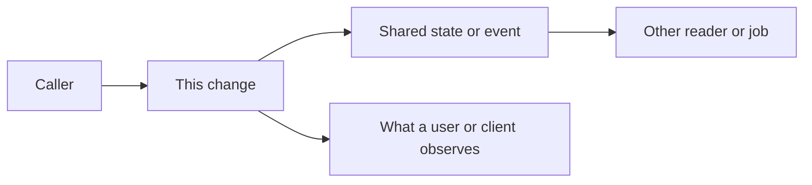

# Analytical thinking: graph the impact

I should get into the habit of more analytical thinking. Fixing a bug or implementing a change is the local move. Before and while I do that, I should think about how the change will impact the project: graph that impact, and peek at how other pieces of the system could be affected.

The habit is the pause between "I know where to edit" and "the change is done."

## The realization

A task arrives as a bug or a feature, and the shortest path is to change the function where the symptom shows up. That path closes the task. It leaves the rest of the project unexamined.

The impact of a change is often somewhere else:

- A caller that was relying on the old rejection, the old timing, or the old shape of the result.
- A piece of state, an event, or a schema that another job, query, or service reads.
- A user-visible surface that shifts even though the edit was one condition in one module.
- A neighbor that still speaks the old concept after this module started speaking a new one.

If I only repair the place I first opened, those couplings stay implicit. They show up later as a second bug, a review comment, or a production surprise.

Analytical thinking, here, means making the impact explicit before treating the change as finished.

## What "graph the impact" means

The graph is a small map of this change, with real names from the task. It can be a sketch, a short list of edges, or a sentence: "A calls B, B writes C, D reads C."

It has to name:

- **The change itself**, as behavior, data, or contract. "Orders in status X will no longer enqueue a retry" is a change. "I will add a condition in `retry.go`" is a location.
- **The edges.** Callers, callees, shared state, events, schemas, config, jobs, and what a user or another client observes. A handful of edges is enough. This is a map of neighbors, not an architecture diagram of the whole system.
- **Which edges might change meaning.** Some neighbors will not care. The ones that assumed the old behavior are the ones to open. Silent assumptions matter more than noisy ones.

Replace each box with a name from the task. A box I cannot name is a box I have not looked at yet.

## What "peek" means

Peeking is opening the specific other piece the graph pointed at and answering one question: does this piece still do the right thing if my change lands?

A peek is a targeted read:

- The caller that builds the input I just tightened.
- The consumer of the event I just stopped emitting.
- The query or job that reads the state I just started writing differently.
- The config or flag that selects this path in production.

The graph is a guess until this step. If the peek surprises me, the graph was incomplete: add the missing edge and peek again. The habit is stopping at the surprise. A perfect diagram is not the goal.

## The practice

On the next change that another piece of the system could observe:

1. **Write one sentence of impact** before editing, or as soon as I know where the edit will be. If the sentence only names a file, I do not understand the change yet.
2. **List the edges.** Callers, callees, shared state, events, and the user-visible surface.
3. **Mark the edges that assumed the old behavior.**
4. **Peek at the two or three load-bearing neighbors.** Read them. Update the graph if they are not what I expected.
5. **Decide the blast radius in a sentence.** The change stays local, and I can say why. Or it needs a matching change, a test on the boundary the graph named, or a note to the person who owns the other side.
6. **Then implement.**

A typo that nobody can observe does not need this. The cutoff is "could another piece observe this," including a one-line behavior change.

For most changes, the sentence and the edge list belong in the pull request description, so the next reader does not have to rebuild the map. For a change that spans modules, the sketch belongs there too.

## How I will know it is working

- I can describe the impact of a change without naming the function I edited.
- Review surprises come from an ambiguous product decision more often than from a neighbor I never opened.
- Tests sit on a boundary the graph named, as well as on the line I changed.

## Open questions

- How do I keep the graph small when the system is tangled? Five edges and two peeks may be the right ceiling, with a note when I stopped early.
- When the impact is organizational (a change in how we decide, estimate, or review) rather than in code, the "neighbors" are people and processes. The same steps should apply: name the impact, list who else relies on the old behavior, and check with them before calling it done.
